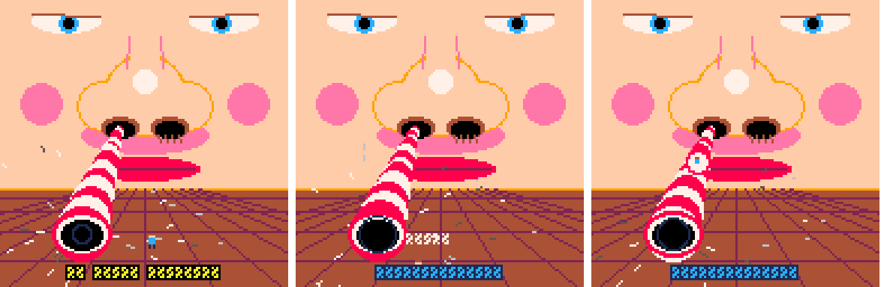

# Wizards of Snort

A PICO-8 maze shooter in the spirit of *Wizard of Wor*. A tiny explorer gets
snorted up a straw into a giant nose, and has to clear nose-hair mazes of dust
monsters.

## Play

Open `wizards_of_snort.p8` in PICO-8 and type `run` (or drag the file onto the
PICO-8 window).

After the title screen, a short story explains how you ended up in there:
X advances (or finishes the current page), Z skips straight to the game.

- Arrow keys: move
- X / Z: fire saline spray (one shot on screen at a time)

| Monster     | Points | Notes                                        |
|-------------|--------|----------------------------------------------|
| Dust bunny  | 100    | slow                                         |
| Pollen puff | 200    | faster, smarter                              |
| Dust mite   | 500    | invisible unless you're close                |
| Booger King | 2500   | appears after each wave, escapes after 10 s  |

You have a 6-segment health bar at the top of the screen. A monster bumping
into you costs 2 segments and a dust ball costs 1, with a moment of
invulnerability after each hit. Run out and you lose a life. Health refills
fully on a new life and partly (+3) at the start of each level.

### Power-ups

Every so often a power-up appears somewhere in the maze, pulsing. Grab it
before it blinks out (about 10 s). Each lasts 8 seconds; active ones show at
the bottom of the screen with a timer, and you can stack them.

| Power-up       | Effect                                                        |
|----------------|---------------------------------------------------------------|
| Menthol rush   | Move about 70% faster, with a minty trail                     |
| Tissue shield  | Invulnerable: monsters and dust balls can't hurt you          |
| Rapid spray    | Up to 3 shots on screen, faster shots, hold the button to auto-fire |

### Nine levels and the Snot Lord

There are nine levels, from the left nostril all the way to the mucus core.
On levels 1-8 the Booger King shows up once the dust is cleared. On level 9 you
face the final boss instead: **the Snot Lord**, a giant glob that oozes
straight through the nose hairs toward you. It has 60 hit points (bar on the
top border), fires rings and aimed spreads of slow mucus globs that pass
through walls, calls in a dust minion now and then, and every so often crusts
over grey for a second so your shots bounce off. At half health it gets
furious: a little faster, with more globs and minions.

Beat it and you get the ending: the nose winds up, sneezes, and you're blasted
back out into the open.

Extra life every 10,000 points. High score is saved.

## Files

- `wizards_of_snort.p8` — the cartridge (generated)
- `game.lua` — game source
- `build.py` — builds the cartridge: packs `game.lua` with the sprites and
  sound effects defined in Python (`python3 build.py`, needs Pillow for the
  sprite-sheet preview)
- `tools/harness.lua` — a minimal PICO-8 API stand-in for headless smoke tests
  and screenshots, run with a stock Lua 5.4:
  `lua tools/harness.lua wizards_of_snort.p8 smoke 1`, `... shots`, or `... final`
  (jumps to level 9, fights the boss and plays the ending)

Tuning: overall pace (`pspd`, `espd`), health (`maxhp`) and power-up duration
(`pdur`) are at the top of
`game.lua`; per-monster speed, chase behavior and points are in the `kt` table.
